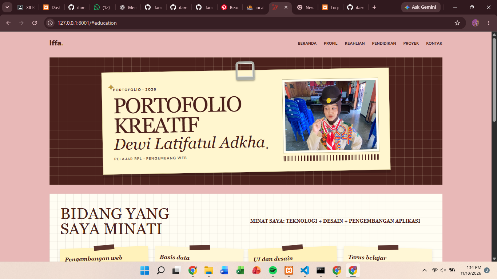
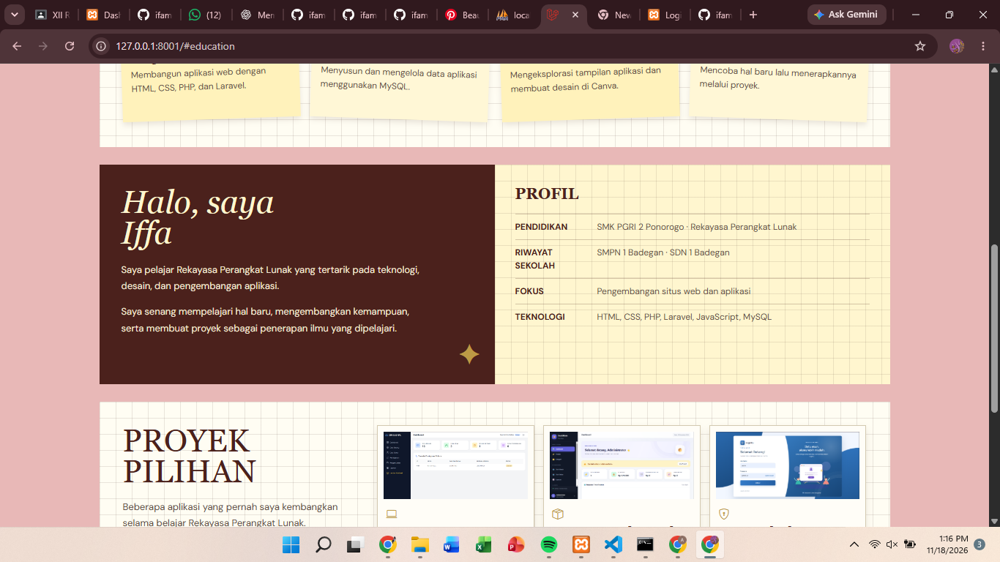
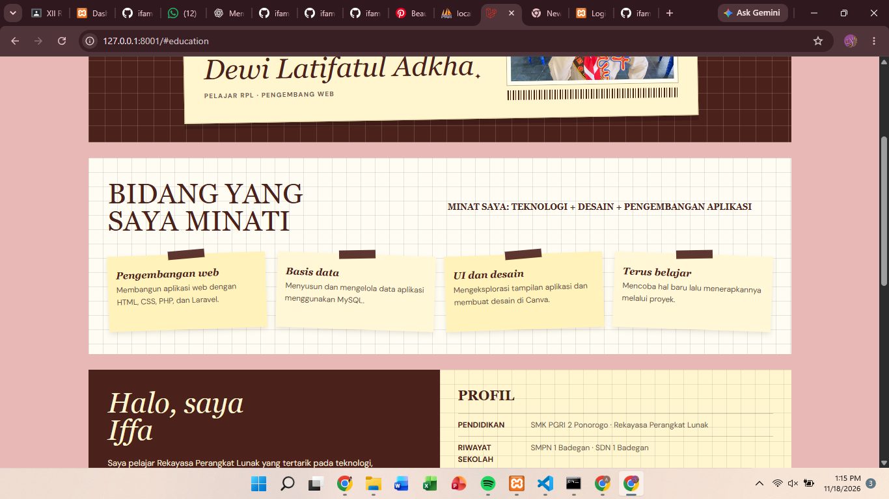
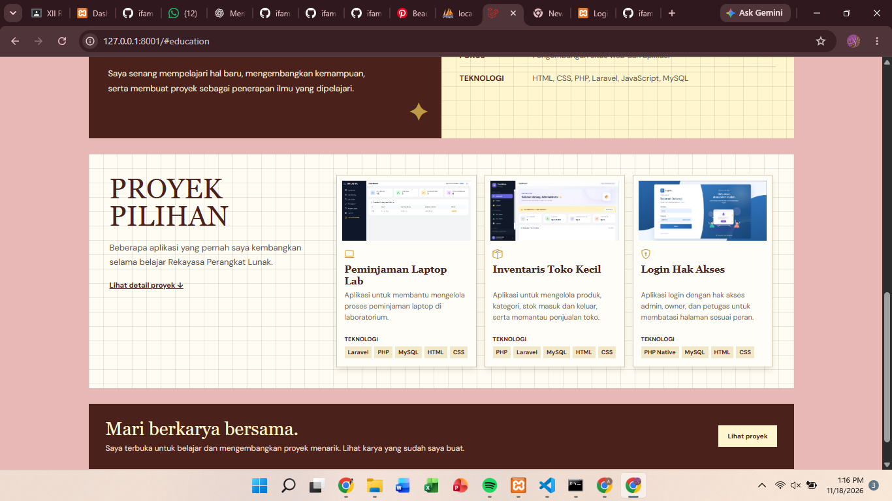
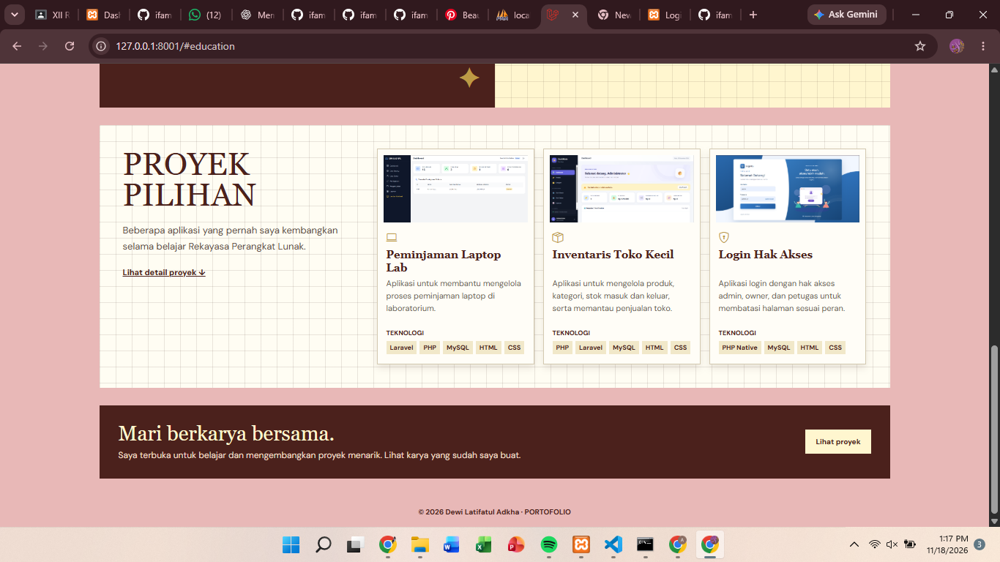

# PORTOFOLIO IFFA

Personal Portfolio Website merupakan aplikasi website portofolio pribadi yang dikembangkan menggunakan Laravel.

## Tentang Aplikasi

Website ini dibuat sebagai media untuk memperkenalkan diri, menampilkan kemampuan, riwayat pendidikan, pengalaman, serta berbagai proyek yang telah dikerjakan.

## Fitur

- Home
- About Me
- My Skills
- Education
- My Projects
- Contact
- Admin Dashboard
- Pengelolaan data portofolio

## Teknologi

- Laravel
- PHP
- MySQL
- HTML
- CSS
- JavaScript
- Bootstrap Icons

## Instalasi

1. Clone repository:

   ```bash
   git clone https://github.com/ifamuklis764-max/portofolio_iffa.git
   ```

2. Masuk ke folder project:

   ```bash
   cd portofolio_iffa
   ```

3. Install dependency:

   ```bash
   composer install
   ```

4. Salin file konfigurasi:

   ```bash
   copy .env.example .env
   ```

5. Generate application key:

   ```bash
   php artisan key:generate
   ```

6. Buat database MySQL bernama `portofolio_iffa` dan sesuaikan konfigurasi `.env`.

7. Jalankan migration:

   ```bash
   php artisan migrate
   ```

8. Jalankan aplikasi:

   ```bash
   php artisan serve
   ```

## Developer

**Dewi Latifatul Adkha**

Student of Software Engineering

SMK PGRI 2 Ponorogo

## License

This project is developed for educational and personal portfolio purposes.

## 📸 Screenshots

### Home


### Profil


### Pendidikan


### Proyek


### Kontak
